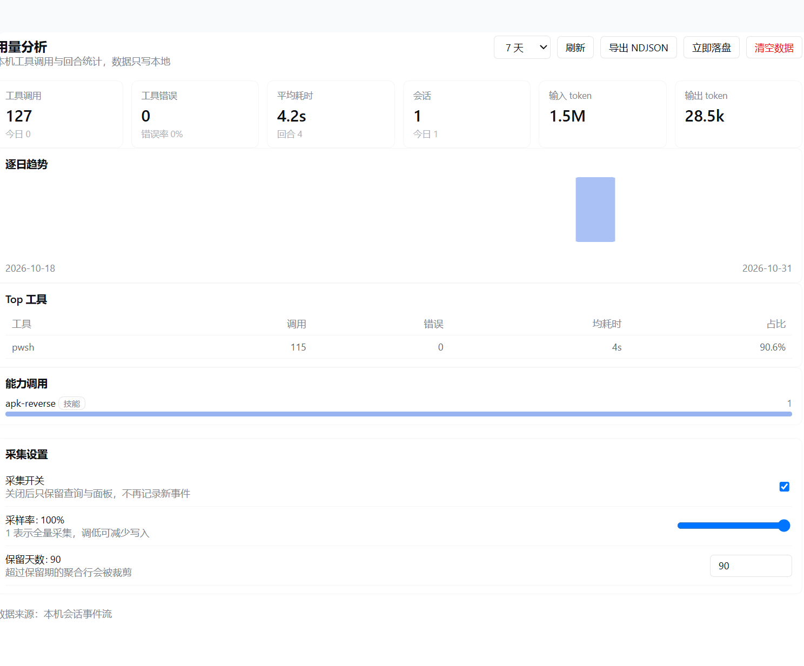

English | [简体中文](README.zh-CN.md)

# dsh-plugin-usage-analytics

A **local-only usage analytics plugin for DeepSeek Harness (DSH)**: it subscribes to session events, aggregates tool calls, turns, errors, latencies and capability usage into daily rows, renders them in a sidebar panel, and exposes a local HTTP query API. Defaults to **local mode with zero outbound traffic** and never collects any message bodies.


> Image note: the image above is the `icon.svg` shipped with the plugin (32×32, shared by the sidebar and the plugin list). A real panel capture is shown under "Panel" below (`assets/panel-usage.png`, taken 2026-11-01 on DSH 0.2.1-rc.3); validation conclusions live in the "validation status" section of [`docs/design-mapping.md`](docs/design-mapping.md).

## Features

- **Zero dependencies**: plain ESM JavaScript that only imports `node:` builtins (`node:crypto`); no TypeScript or bundler toolchain — install and it runs.
- **Three-layer idempotency**: per-session cursor (`meta.cursors[sid]`) + fork boundary (`inheritedEventCount`) + backfill dedupe; restarts, reloads and forks never double-count.
- **Dirty tables only**: in-memory aggregation, and only dirty tables are flushed to disk every `flushIntervalMs` (default 10s), keeping write amplification under control.
- **Graceful degradation**: falls back to an in-memory store when `storageDomain` is unavailable; the panel and API keep working, but data is lost on restart (`diagnostics.storage.kind === 'memory'`).
- **Switchable**: `collect:false` stops ingestion, `selfExclude` excludes this plugin's own tool calls, `retentionDays` controls the retention window (pruning both memory and disk).
- **Fence + rate limit**: the `Host` header must be a loopback name (`127.0.0.1`/`localhost`/`[::1]`, which blocks DNS rebinding), plus `Sec-Fetch-Site` and `Origin`/`Host` consistency checks, 10 write requests per second, and a 64KB body cap.

## Install

Preferred:

```bash
dsh plugin --profile <profile> add github:wjf1/dsh-plugin-usage-analytics
```

No build step: `package.json` declares `dsh.bundle` (`patch: ./cordis.patch.yml`) and `dsh.client` (web UI), and the `lib/` artifacts are committed to the repository.

Offline install / manual equivalent (this is how the author's machine runs it; equivalent to the command above):

1. Put the package directory into the profile's `node_modules` (junction or plain copy):
   `C:\Users\admin\.dsh\profiles\desktop\node_modules\dsh-plugin-usage-analytics`
2. Append `"dsh-plugin-usage-analytics"` to the `dsh.profile.bundles` array in the profile's `package.json` (**not** to `dependencies` — a bundle needs no npm resolution).
3. Restart DSH (**a newly added bundle can load through HMR; replacing an installed package requires a restart**; this repo uses a junction, so edits show up immediately, but the first load still requires the host to pick up the bundle list).

Once loaded, open "Usage Analytics" in the sidebar to see the panel; `GET /dsh-plugin-usage-analytics/api/` should return `{"ok":true,"value":{"ready":true,...}}`.

## Configuration

Keys are written under `config` in `cordis.patch.yml` (whitelisted keys can also be hot-edited at runtime via the settings API):

| Key | Default | Meaning |
|---|---|---|
| `mode` | `local` | `local` keeps everything on this machine; `remote`/`opt-in` are reserved for future reporting and produce no outbound traffic today |
| `collect` | `true` | Master switch; `false` stops consuming session events |
| `sampleRate` | `1` | Sampling rate (0..1), thins `tool/call`+`tool/result` pairs; drops are counted in `meta.sampled` |
| `retentionDays` | `90` | Retention window (1..400), pruned by a scheduled job |
| `maxEventsPerDay` | `200000` | Per-day event cap; overflow is counted in `meta.dropped` |
| `flushIntervalMs` | `10000` | Dirty-table flush interval, minimum 2000 |
| `layout` | `single` | Storage layout: `single` rewrites the whole unit / `per-record` writes row by row (safer for small datasets; watch the small-file count as data grows) |
| `selfExclude` | `false` | Exclude calls made by this plugin itself |
| `profileName` | `null` | Profile suffix for the storage domain. Auto-detected by default (`config` → `profile` service → `app.profile` → `DSH_PROFILE`/`DSH_PROFILE_NAME`/`DSH_PROFILE_DIR` → `--profile=` → `profiles/<name>` under `ctx.baseDir` → `default`); set it explicitly to guarantee isolation between profiles |

### Validation status (real host)

| Check | Result | Evidence |
|---|---|---|
| Bundle loaded by host | ✅ | `diagnostics.version` populated, `routes` registered |
| HTTP prefix reachable | ✅ | `GET /dsh-plugin-usage-analytics/api/` → `ready:true` (after signed-cookie auth) |
| Real data aggregated | ✅ | 1181 calls / 22 errors / 4 sessions / tokensIn 3,354,030 / avgMs 3505 |
| Storage persisted | ✅ | `storage.kind=domain`, `writes=158`, `flushes=32`, a 14KB `plugin_analytics_default.json` under `C:\Users\admin\.dsh\storages` |
| JSON-RPC surface | ✅ | `POST /` `diagnostics` returns the standard envelope |
| Client half registered | ✅ | GUI boot manifest lists `dsh-plugin-usage-analytics/client.js` |
| Panel eyeball check | ✅ | Confirmed 2026-11-01 in the DSH 0.2.1-rc.3 GUI sidebar: 6 KPI cards, daily trend, top tools, capability calls and collection settings all render correctly (`assets/panel-usage.png`) |

## Panel



Sidebar entry "Usage Analytics". The main panel contains:

- 6 KPI cards: tool calls, errors, error rate, average latency, sessions, tokens in/out within the window;
- A 14-day trend bar chart (hand-drawn SVG, no third-party chart library);
- A top tools table (calls, errors, average latency, share);
- Capability distribution (call share of non-native capabilities such as MCP / skill);
- Settings area: `collect` checkbox, `sampleRate` slider, `retentionDays` number input;
- Actions area: refresh, flush now, clear local data (with confirmation), window-size switch (1/7/14/30/90).

Styling uses only the host's `--dsw-alias-*` theme tokens (with fallback values) and follows the light/dark theme.

## HTTP API

Prefix: `API_PREFIX = /dsh-plugin-usage-analytics/api`.

### JSON-RPC methods (design §7.5)

`POST <prefix>/` with body `{ "method": "...", "params": { ... } }`; the response is `{ok:true,value}` or `{ok:false,error:{code,message,retryable?,detail?}}`.

| method | params | Meaning |
|---|---|---|
| `overview` | `{range}` | 4 KPIs + window summary + top tools |
| `plugins` | `{range,q?,sort?,cursor?}` | Tool/capability leaderboard, 50 per page |
| `plugin` | `{pluginId,range}` | Per-day detail for one tool |
| `capabilities` | `{range,type?,top?}` | Capability ranking (mcp/skill) |
| `env` | `{range}` | Host and plugin versions, storage state |
| `series` | `{range,metric}` | Daily series (calls/errors/sessions/turns) |
| `events` | `{limit?}` | Recent session summaries (aggregated granularity, see the deviation notes) |
| `settings.get` / `settings.set` | `{}` / `{patch}` | Read/update settings (whitelisted) |
| `consent.get` / `consent.set` | `{}` / `{mode,version}` | Consent state (only local/off supported) |
| `report.preview` / `report.now` / `report.clear` | `{}` | Report preview/now/clear (reporting is not enabled; returns an empty payload) |
| `data.delete` | `{confirm:'DELETE'}` | Delete all local data |
| `export` | `{range,format:'json'\|'csv'\|'ndjson'}` | Inline export |
| `diagnostics` | `{}` | Runtime diagnostics |
| `reset` | `{}` | Clear and rescan |

`range` accepts a number, `"7d"`, `{days}`, or `{from,to}`, capped at 366 days; error codes `E_ORIGIN/E_RATE/E_RANGE/E_PAYLOAD/E_CONSENT/E_METHOD/E_INTERNAL` map to the status-code table in design §7.5.

### Convenience REST endpoints (used by the panel)

`GET /`, `/overview?days=`, `/series?days=`, `/sessions?limit=`, `/tools?days=`, `/tool?name=&days=`, `/settings`, `/diagnostics`, `/export` (NDJSON download); `POST /settings`, `/flush`, `/reset?confirm=RESET`. They share the same aggregation functions as JSON-RPC.

> Pagination caps are defined once in `lib/shared.js` as `PAGE_SIZE` / `MAX_PAGE_SIZE` (shared by REST and JSON-RPC); `/sessions` defaults to 20 rows.
>
> Both `POST /reset` and the RPC `reset` method require an explicit confirmation (`?confirm=RESET` / `params.confirm:"RESET"`), otherwise they return `E_CONFIRM`.

## CLI export (`dsh-usage`)

A zero-dependency CLI that exports the locally collected daily table as JSONL / CSV (ccusage-style consumption). It does not go through the DSH host and does not need the panel to be online — it reads the on-disk storage snapshot directly:

```bash
# By profile (default `default`: $DSH_HOME or ~/.dsh/storages/plugin_analytics_<profile>.json)
dsh-usage jsonl --from 2026-11-01 --to 2026-11-30
dsh-usage csv --profile desktop --out usage-11.csv

# Or point at a snapshot file explicitly (backups and test fixtures work too)
node bin/dsh-usage.mjs jsonl --file /path/to/plugin_analytics_default.json
```

Options:

| Option | Meaning |
|---|---|
| `<jsonl\|csv>` | Output format; JSONL = one line per day, CSV = header row + one row per day (dates ascending) |
| `--from` / `--to` | Inclusive date-range filter (`YYYY-MM-DD`); optional |
| `--out <file>` | Write to a file (stderr reports the day count); stdout by default |
| `--file <path>` | Explicit snapshot path (single-layout JSON); probed via `--profile` by default |
| `--profile <name>` | Storage profile name (default `default`; separates multiple profiles) |
| `--home <dir>` | DSH home directory (default `$DSH_HOME`, otherwise `~/.dsh`) |

Exit codes: 0 success; 1 data file missing/corrupt (stderr lists sibling snapshots); 2 usage error. `package.json` declares `bin.dsh-usage`, so `npm link` / a global install gives you `dsh-usage` directly; `node bin/dsh-usage.mjs` is equivalent.

Each line uses the fields of the `daily` storage table:

| Field | Meaning |
|---|---|
| `day` | Local date `YYYY-MM-DD` |
| `events` | Session events consumed that day |
| `toolCalls` / `toolErrors` | Tool calls / failed calls (the "request" proxy) |
| `steps` / `turns` | Model steps / conversation turns |
| `sessions` | Sessions first seen that day |
| `tokensIn` / `tokensOut` | Token counters |
| `ms` / `msSamples` / `maxMs` | Tool latency sum / samples / max (avg = `ms / msSamples`) |
| `panels` / `commands` | Panel opens / command invocations |
| `mcp` / `skills` | MCP / skill capability calls |
| `dropped` | Events dropped (sampling / per-day cap) |

JSONL matches the REST `/export` NDJSON shape (`{"kind":"daily","day":"2026-10-28","events":510,"toolCalls":127,...}`); parsing reuses `lib/store.js` (schema normalization + meta migration), the same source as the panel / HTTP queries.

## Storage

One domain per profile: `plugin_analytics_<profile name>` (via `storageDomain.open`), defaulting to `layout: 'single'`; the on-disk location is decided by the host's `DSH_HOME/storages`. Tables:

- `meta`: `installId`, `settings`, `cursors`, `dropped`, `sampled`
- `daily`: per-day totals (toolCalls/toolErrors/turns/sessions/tokens/ms)
- `toolDaily`: `day + tool` dimension
- `capDaily`: `day + capability key` dimension (MCP / skill)
- `sessions`: first-seen and cumulative session stats (turns/toolCalls/errors/model)

## Privacy

- Records **event metadata only**: tool name, capability class, ok/error, latency, short session hash, model name, turn/step counts, token counters.
- Never records: message bodies, raw tool arguments, tool outputs, file paths, usernames, or environment variables.
- Session IDs are stored as `sha256(sessionId + ':' + installId)` truncated to 16 hex chars; reinstalling generates a fresh `installId`, so history cannot be stitched back together.
- Local mode by default; the code contains no outbound requests (prove it with `grep -R "http" lib/` — only `http://localhost` appears, as a URL-parsing baseline).

## Development

No build step — edit `lib/*.js` directly and run:

```bash
node --test test/store.test.mjs test/aggregate.test.mjs test/collector.test.mjs \
           test/routes.test.mjs test/rpc.test.mjs test/index.test.mjs test/dsh-usage.test.mjs
```

94 tests, all passing. Passing only the `test/` directory makes `node --test` fail on Windows (`Cannot find module ...\test`) — list the files explicitly.

## Known limitations

See [`docs/design-mapping.md`](docs/design-mapping.md): the `plugins`/`env`/`events`/`report` methods, the SDK and the reporting channel are deliberately degraded in this implementation (the data model keeps no plugin list and no per-event rows); each case is listed with its reason and the substitute used instead. Design v1.0 and its review report live outside this repository.

## License

MIT.
