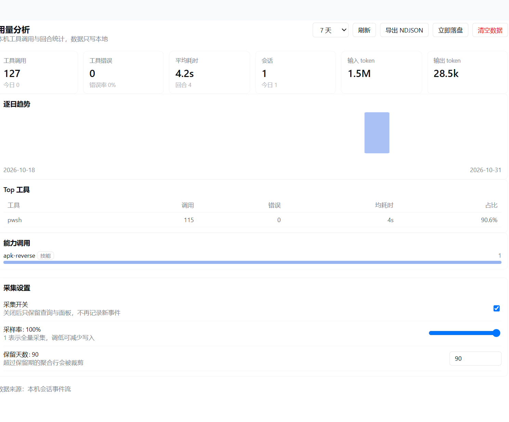

[English](README.md) | 简体中文

# dsh-plugin-usage-analytics

一款给 DeepSeek Harness（DSH）用的**本地用量分析插件**：订阅会话事件，把工具调用、回合、错误、耗时与能力使用情况聚合成日表，在侧栏面板里展示，并对外提供一套本地 HTTP 查询接口。默认 **local 模式、零出站**，不采集任何消息正文。


> 配图说明：上图是本插件随包发布的 `icon.svg`（32×32，侧栏与插件列表共用）。面板实拍见下方「面板」一节（`assets/panel-usage.png`，2026-11-01 于 DSH 0.2.1-rc.3 真机截取），验收结论见 [`docs/design-mapping.md`](docs/design-mapping.md) 的「验证状态」一节。

## 特性

- **零依赖**：纯 ESM JavaScript，只 `import` `node:` 内置模块（`node:crypto`），不需要 TS/打包工具链，装上即可跑。
- **三层幂等**：游标（`meta.cursors[sid]`）+ fork 起点（`inheritedEventCount`）+ 回填去重，重启、重载、fork 都不会重复计数。
- **脏表才写**：内存聚合 → 每 `flushIntervalMs`（默认 10s）只把脏表落盘，写放大可控。
- **可降级**：取不到 `storageDomain` 时自动切内存档，面板与接口照常工作，只是重启即丢（`diagnostics.storage.kind === 'memory'`）。
- **可关**：`collect:false` 停止采集，`selfExclude` 排除本插件的工具调用，`retentionDays` 控制保留天数（同时裁剪内存与落盘）。
- **围栏与限流**：`Host` 必须是回环名（`127.0.0.1`/`localhost`/`[::1]`，挡 DNS rebinding）+ `Sec-Fetch-Site` + `Origin`/`Host` 一致性校验，写方法面每秒 10 次上限，请求体 64KB 上限。

## 安装

正路（推荐）：

```bash
dsh plugin --profile <profile> add github:wjf1/dsh-plugin-usage-analytics
```

无需构建：`package.json` 声明了 `dsh.bundle`（`patch: ./cordis.patch.yml`）与 `dsh.client`（web UI），`lib/` 产物随仓库提交。

离线安装 / 手工等价（本机当前就是这种装法，等价于上面三步）：

1. 把包目录放进 profile 的 `node_modules`（Junction 或直接拷贝）：
   `C:\Users\admin\.dsh\profiles\desktop\node_modules\dsh-plugin-usage-analytics`
2. 在 profile 的 `package.json` 的 `dsh.profile.bundles` 数组里追加 `"dsh-plugin-usage-analytics"`（**不要**加进 `dependencies`，bundle 不需要 npm 解析）。
3. 重启 DSH（**新增 bundle 可以靠 HMR 加载，替换已装包必须重启**；本仓库采用 Junction，改动即时可见但首次加载仍需宿主扫到 bundle 列表）。

装好后打开侧栏「用量分析」即可看到面板；`GET /dsh-plugin-usage-analytics/api/` 应返回 `{"ok":true,"value":{"ready":true,...}}`。

## 配置

写在 `cordis.patch.yml` 的 `config` 段（也可在运行时通过设置接口热改，仅白名单键）：

| 键 | 默认 | 说明 |
|---|---|---|
| `mode` | `local` | `local` 只落本地；`remote`/`opt-in` 为未来上报预留，当前不产生任何出站流量 |
| `collect` | `true` | 总开关，`false` 时不再消费会话事件 |
| `sampleRate` | `1` | 采样率（0..1），按 `tool/call`+`tool/result` 成对抽稀，丢弃量记在 `meta.sampled` |
| `retentionDays` | `90` | 保留天数（1..400），定时任务按此裁剪 |
| `maxEventsPerDay` | `200000` | 单日事件上限，超出记 `meta.dropped` |
| `flushIntervalMs` | `10000` | 合并落盘间隔，最小 2000 |
| `layout` | `single` | 存储布局，`single` 整单元重写 / `per-record` 逐条写（小数据量更稳，大数据量注意小文件数量） |
| `selfExclude` | `false` | 是否排除本插件自身产生的调用 |
| `profileName` | `null` | 存储 domain 的 profile 后缀。默认自动探测（`config` → `profile` 服务 → `app.profile` → `DSH_PROFILE`/`DSH_PROFILE_NAME`/`DSH_PROFILE_DIR` → `--profile=` → `ctx.baseDir` 的 `profiles/<name>` → `default`），显式指定可保证多 profile 隔离 |

### 验证状态（真机）

| 检查项 | 结果 | 证据 |
|---|---|---|
| 宿主加载 bundle | ✅ | `diagnostics.version` 有值、`routes` 注册成功 |
| HTTP 前缀可达 | ✅ | `GET /dsh-plugin-usage-analytics/api/` → `ready:true`（签名 cookie 鉴权后） |
| 真实数据聚合 | ✅ | 1181 次调用 / 22 次错误 / 4 会话 / tokensIn 3,354,030 / avgMs 3505 |
| 存储落盘 | ✅ | `storage.kind=domain`、`writes=158`、`flushes=32`、`C:\Users\admin\.dsh\storages\plugin_analytics_default.json` 14KB |
| JSON-RPC 面 | ✅ | `POST /` 的 `diagnostics` 返回统一信封 |
| 客户端包注册 | ✅ | GUI boot 清单含 `dsh-plugin-usage-analytics/client.js` |
| 面板肉眼验收 | ✅ | 2026-11-01 于 DSH 0.2.1-rc.3 GUI 侧栏实拍确认：6 张 KPI 卡、逐日趋势、Top 工具、能力调用、采集设置全部渲染正常（`assets/panel-usage.png`） |

## 面板



侧栏入口「用量分析」，主面板包含：

- 6 张 KPI 卡：窗口内工具调用、错误数、错误率、平均耗时、会话数、tokens 进出；
- 14 日趋势柱状图（SVG 自绘，不引第三方图表库）；
- Top 工具表（调用数、错误数、平均耗时、占比）；
- 能力分布（MCP / skill 等非原生能力的调用占比条）；
- 设置区：`collect` 勾选、`sampleRate` 滑杆、`retentionDays` 数字框；
- 操作区：刷新、立即落盘、清空本地数据（二次确认）、窗口天数切换（1/7/14/30/90）。

配色只用宿主 `--dsw-alias-*` 主题 token（带回退值），跟随浅色/深色主题。

## HTTP 接口

前缀 `API_PREFIX = /dsh-plugin-usage-analytics/api`。

### JSON-RPC 方法面（设计 §7.5）

`POST <prefix>/`，请求体 `{ "method": "...", "params": { ... } }`，响应 `{ok:true,value}` 或 `{ok:false,error:{code,message,retryable?,detail?}}`。

| method | params | 说明 |
|---|---|---|
| `overview` | `{range}` | 4 KPI + 窗口汇总 + Top 工具 |
| `plugins` | `{range,q?,sort?,cursor?}` | 工具/能力榜，每页 50 |
| `plugin` | `{pluginId,range}` | 单工具逐日明细 |
| `capabilities` | `{range,type?,top?}` | 能力排行（mcp/skill） |
| `env` | `{range}` | 宿主与插件版本、存储状态 |
| `series` | `{range,metric}` | 逐日序列（calls/errors/sessions/turns） |
| `events` | `{limit?}` | 最近会话摘要（聚合粒度，见偏差说明） |
| `settings.get` / `settings.set` | `{}` / `{patch}` | 读/改设置（白名单） |
| `consent.get` / `consent.set` | `{}` / `{mode,version}` | 同意态（只支持 local/off） |
| `report.preview` / `report.now` / `report.clear` | `{}` | 上报预览/立即/清空（未启用上报，返回空载荷） |
| `data.delete` | `{confirm:'DELETE'}` | 删除本地全部数据 |
| `export` | `{range,format:'json'\|'csv'\|'ndjson'}` | 内联导出 |
| `diagnostics` | `{}` | 运行态诊断 |
| `reset` | `{}` | 清空并重扫 |

`range` 接受数字、`"7d"`、`{days}`、`{from,to}`，上限 366 天；错误码 `E_ORIGIN/E_RATE/E_RANGE/E_PAYLOAD/E_CONSENT/E_METHOD/E_INTERNAL` 映射到设计 §7.5 的状态码表。

### REST 便捷端点（面板使用）

`GET /`、`/overview?days=`、`/series?days=`、`/sessions?limit=`、`/tools?days=`、`/tool?name=&days=`、`/settings`、`/diagnostics`、`/export`（NDJSON 下载）；`POST /settings`、`/flush`、`/reset?confirm=RESET`。与 JSON-RPC 共用同一批聚合函数。

> 分页上限统一由 `lib/shared.js` 的 `PAGE_SIZE` / `MAX_PAGE_SIZE` 定义（REST 与 JSON-RPC 共用），`/sessions` 默认 20 条。
>
> `POST /reset` 与 RPC 的 `reset` 都必须显式带确认（`?confirm=RESET` / `params.confirm:"RESET"`），否则回 `E_CONFIRM`。

## CLI 导出（`dsh-usage`）

零依赖 CLI：把本地采集的日表导出为 JSONL / CSV（对标 ccusage 的消费形态）。不经过 DSH 宿主、不需要面板在线——直接读取落盘的存储快照：

```bash
# 按 profile 探测快照（默认 default：$DSH_HOME 或 ~/.dsh/storages/plugin_analytics_<profile>.json）
dsh-usage jsonl --from 2026-11-01 --to 2026-11-30
dsh-usage csv --profile desktop --out usage-11.csv

# 显式指定快照文件（备份、测试夹具都能导）
node bin/dsh-usage.mjs jsonl --file /path/to/plugin_analytics_default.json
```

参数：

| 参数 | 含义 |
|---|---|
| `<jsonl\|csv>` | 输出格式；JSONL 每日一行，CSV 首行表头 + 每日一行（日期升序） |
| `--from` / `--to` | 闭区间日期过滤（`YYYY-MM-DD`，含端点），缺省不限 |
| `--out <file>` | 写入文件（stderr 提示写入天数）；缺省输出到 stdout |
| `--file <path>` | 显式快照路径（single 布局 JSON），缺省按 `--profile` 探测 |
| `--profile <name>` | 存储 profile 名（默认 `default`，多 profile 用它区分） |
| `--home <dir>` | DSH 主目录（默认 `$DSH_HOME`，否则 `~/.dsh`） |

退出码：0 成功；1 数据文件缺失 / 损坏（stderr 会列出同目录可用快照）；2 用法错误。`package.json` 已声明 `bin.dsh-usage`，`npm link` 或全局安装后可直接用 `dsh-usage`，否则用 `node bin/dsh-usage.mjs` 等价。

每行字段与 `daily` 存储表一致：

| 字段 | 含义 |
|---|---|
| `day` | 本地日期 `YYYY-MM-DD` |
| `events` | 当日消费的会话事件数 |
| `toolCalls` / `toolErrors` | 工具调用数 / 失败数（"请求数"口径） |
| `steps` / `turns` | 模型步数 / 对话回合数 |
| `sessions` | 当日首见会话数 |
| `tokensIn` / `tokensOut` | token 计数 |
| `ms` / `msSamples` / `maxMs` | 工具耗时总和 / 样本数 / 最大值（均值 = `ms / msSamples`） |
| `panels` / `commands` | 面板打开 / 命令调用次数 |
| `mcp` / `skills` | MCP / skill 能力调用次数 |
| `dropped` | 丢弃事件数（采样 / 单日上限） |

JSONL 形态与 REST `/export` 的 NDJSON 一致（`{"kind":"daily","day":"2026-10-28","events":510,"toolCalls":127,...}`）；数据解析直接复用 `lib/store.js`（schema 归一化 + meta 迁移），与面板 / HTTP 查询同源。

## 存储

每个 profile 一个 domain：`plugin_analytics_<profile 名>`（`storageDomain.open`），默认 `layout: 'single'`，落盘位置由宿主的 `DSH_HOME/storages` 决定。表：

- `meta`：`installId`、`settings`、`cursors`、`dropped`、`sampled`
- `daily`：按天的总量（toolCalls/toolErrors/turns/sessions/tokens/ms）
- `toolDaily`：`day + tool` 维度
- `capDaily`：`day + 能力键` 维度（MCP / skill）
- `sessions`：会话首见与累计（turns/toolCalls/errors/model）

## 隐私

- 只记录**事件元数据**：工具名、能力分类、成败、耗时、会话短哈希、模型名、回合/步数、token 计数。
- **不记录**：消息正文、工具参数原文、工具输出、文件路径、用户名、环境变量。
- 会话 ID 以 `sha256(sessionId + ':' + installId)` 截 16 位存储，卸载重装即换新 `installId`，历史无法互相拼接。
- 默认 `local` 模式，代码里没有任何出站请求（可 `grep -R "http" lib/` 自证：只有 `http://localhost` 的 URL 解析基线）。

## 开发

无构建步骤，直接改 `lib/*.js`：

```bash
node --test test/store.test.mjs test/aggregate.test.mjs test/collector.test.mjs \
           test/routes.test.mjs test/rpc.test.mjs test/index.test.mjs test/dsh-usage.test.mjs
```

94 条测试全通过。`node --test test/`（只给目录）在 Windows 上会报 `Cannot find module ...\test`，必须显式列文件。

## 已知限制

见 [`docs/design-mapping.md`](docs/design-mapping.md)：设计里的 `plugins`/`env`/`events`/`report`/SDK/上报通道在本实现中是**明确降级**（数据模型不含插件清单与逐事件行），逐条列了原因与替代方案。设计 v1.0 与评审报告不在本仓库内。

## 许可证

MIT。
